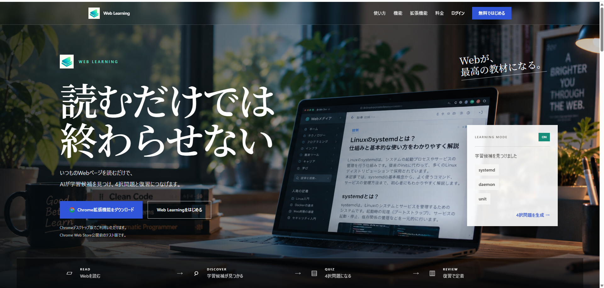
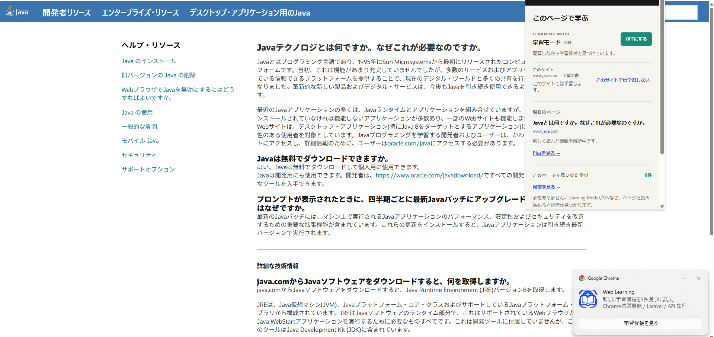
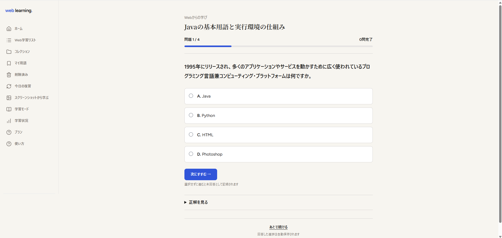
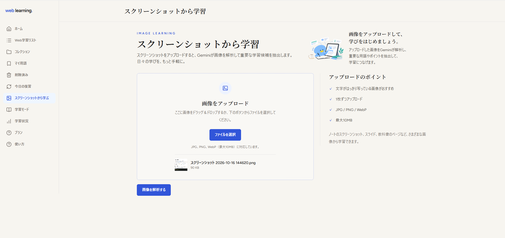
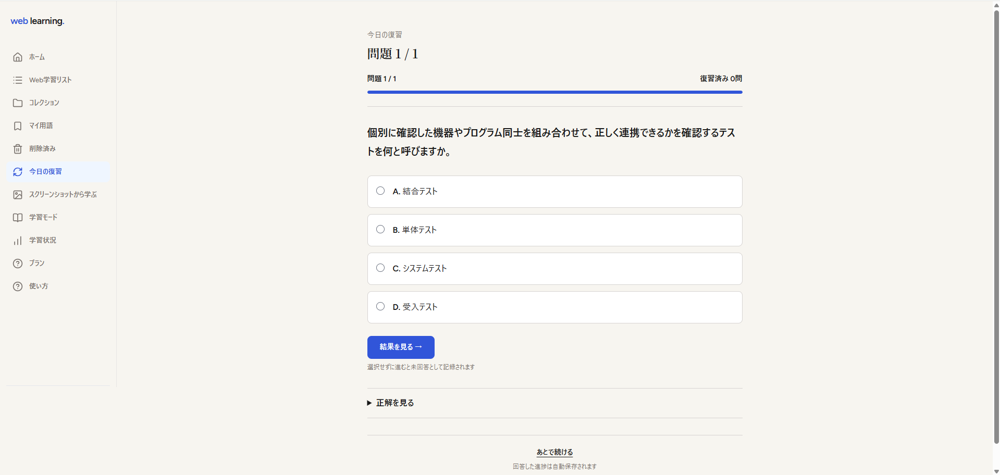
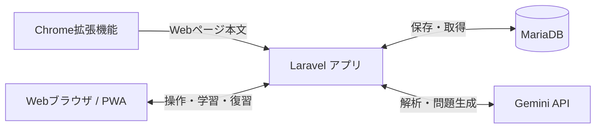

 Web Learning（ウェブラー）

【いつものWeb閲覧を、学びに変える】
Web閲覧をするなかで、AIが学習候補で見つけ４択問題をだし、復習までできる学習アプリです。

**制作区分：自主制作・継続開発中**

[デモサイト](https://web.npo-niigata.com/202604/u/cju5hejf3wos/web-learning/) ｜ [Chrome拡張機能のソース](chrome-extension/)

> デモサイトは検証用の公開環境です。機能・公開状況は変更になる場合があります。

## 1. 制作の背景・目的

新しい分野を勉強したいと思っても、「教材を探す」「単語帳を作る」といった準備が負担になり、学習を始める前にハードルを感じることがあります。

そこで、**普段のWeb閲覧から自然に学びを始められる仕組み**を考えました。

Web Learningは、気になる記事を読む中で学習候補を見つけ、AIによる4択問題の作成と復習につなげるアプリです。学習を始めるまでの操作を少なくし、興味を持った瞬間を学ぶきっかけに変えることを目指しています。

## 2. アプリの利用イメージ

1. **READ｜読む**：Chrome拡張機能の学習モードをONにして、普段どおりWebページを読む。
2. **DISCOVER｜見つける**：ページ本文からGemini APIが学習候補となる用語や概念を抽出する。
3. **QUIZ｜問題にする**：学びたい候補を選び、解説付きの4択問題を生成する。
4. **REVIEW｜復習する**：問題を保存し、解答結果に応じたタイミングで復習する。

Webページだけでなく、スクリーンショットの画像から学習候補を抽出する機能も実装しています。

### 実際の画面

以下は公開検証環境で撮影したWeb Learningの操作画面です。画像をクリックすると拡大できます。

**① トップページ — アプリのコンセプト**

[](docs/screenshots/01-top-page.png)

Web閲覧から学習候補の発見、クイズ、復習につながる流れを紹介しています。

**② Chrome拡張機能 — Web閲覧中の学習候補通知**

[](docs/screenshots/02-chrome-extension.png)

Javaの解説ページを閲覧しながら学習モードをONにした例です。拡張機能のポップアップと、学習候補を検出した際のChrome通知が確認できます。

**③ AIによる4択クイズ**

[](docs/screenshots/03-ai-quiz.png)

Webから抽出した内容をもとに作成した4択問題です。選択肢・進捗・正解の確認を1つの画面で扱えます。

**④ スクリーンショット学習 — 画像アップロード**

[](docs/screenshots/04-screenshot-learning.png)

画像をアップロードしてAI解析する機能の入口です。**この画像は解析前の画面**であり、解析結果の候補一覧ではありません。

**⑤ 今日の復習 — 学習内容の定着**

[](docs/screenshots/05-daily-review.png)

学習した問題を再度解き、解答結果を記録する画面です。

## 3. 主な機能

| 機能 | 内容 |
| --- | --- |
| Chrome拡張機能 | 学習モードの切り替え、Webページ本文の取得、学習候補の通知 |
| Web解析 | Gemini APIによる学習用語・概念の抽出 |
| スクリーンショット学習 | 画像内の内容を解析し、選んだ候補から問題を生成 |
| AI問題生成 | 4択問題、解説、入力式問題文の生成 |
| 学習データの管理 | 単語・学習セット・コレクションの保存と整理 |
| クイズ・復習 | 解答履歴の記録、正誤に応じた復習予定日の更新 |
| 学習状況 | 学習統計とAI利用状況の表示 |
| 認証 | 通常のアカウント認証とGoogleログイン |
| PWA | ホーム画面への追加を想定したWebアプリ対応 |
| 利用回数管理 | Web解析・画像解析の利用実績とプラン別上限の管理 |

※上記はリポジトリで確認できる実装内容を整理したものです。公開環境で全機能が安定動作することを保証するものではありません。

## 4. 使用技術

| 分類 | 技術 | 用途 |
| --- | --- | --- |
| バックエンド | PHP 8.3以上 / Laravel 13 | API、認証、データ処理 |
| フロントエンド | Blade / JavaScript / Alpine.js / Tailwind CSS / Vite | 表示・画面操作 |
| データベース | MariaDB（MySQL互換） | ユーザー、用語、問題、履歴の保存 |
| AI | Google Gemini API | テキスト・画像解析、問題・解説生成 |
| ブラウザ拡張 | Chrome Extension（Manifest V3） | ページ本文の取得、通知、API連携 |
| 関連ライブラリ | Laravel Breeze / Socialite / Cashier | 認証、Googleログイン、決済関連処理 |
| 学習・検証環境 | Rocky Linux / Apache / SSH | Linux・Webサーバーの構築、接続、設定の学習 |
| テスト | Pest / Laravel Feature・Unitテスト | 各機能の検証コード |

※AWS上での稼働実績を示すものではありません。サーバー構築の学習経験とアプリの使用技術を区別して記載しています。

## 5. システム構成



Chrome拡張機能でページ本文を取得し、LaravelのAPIへ送信します。Laravelがリクエストの検証とAI APIへの通信を行い、ユーザーの学習データをデータベースに保存する構成です。

## 6. 開発で工夫したこと

### Chrome拡張機能とLaravelの役割分担

Webページの文章取得と通知はChrome拡張機能、解析・データ管理はLaravelが担当します。拡張機能とサーバーを連携させる際は、接続用トークンを用いてユーザーごとの学習データを扱う設計にしています。

### 公開環境での接続トラブルの解決

ローカル環境で動いていた拡張機能が、公開環境のアプリに接続できない問題がありました。配布用の拡張機能ZIPに、ローカル開発用の `localhost` を参照する設定が残っていたことが原因でした。

接続先URLの設定を見直してZIPを再作成し、公開環境との接続を確認しました。この経験から、アプリのコードだけでなく、**配布物の設定・接続先・実行環境の違いを切り分けて確認する重要性**を学びました。

### 復習スケジュールの管理

一度問題を解いて終わりにしないよう、正誤と復習段階に応じて次回復習日を更新する仕組みを作りました。日付計算は `ReviewScheduleService` に分離し、単体テストも用意しています。

### AI APIの利用履歴と上限管理

Gemini APIのレスポンスから、取得可能な入力・出力トークン数や実行結果を記録します。また、Web解析とスクリーンショット解析の月間利用回数を機能別・ユーザー別に管理し、上限超過時のエラー処理を用意しています。

## 7. 開発を通じて学んだこと

- PHP・Laravelのルーティング、認証、データベース操作と機能分割
- JavaScriptのChrome拡張機能とWeb APIの連携
- 外部APIのレスポンス処理、入力チェック、例外処理
- Linux・Webサーバー構築とローカル／公開環境の違い
- 問題の原因を設定・通信・アプリ処理に分けて調べる姿勢

特に、**ゴールから逆算して必要な設定や処理を一つずつ確認し、解決する過程**に面白さを感じました。

## 8. 今後の改善課題

- Chrome拡張機能の学習候補通知を含む公開環境での動作検証
- 利用者増加時のAPIレート制限・負荷対策
- 監視・ログ管理・セキュリティ対策の強化
- 解析後の学習候補一覧などのスクリーンショット充実と、操作デモ動画の追加

## 9. ローカルでのセットアップ（開発者向け）

PHP、Composer、Node.jsとデータベース環境を準備してください。

```bash
git clone https://github.com/yu8taka8950/web_learning.git
cd web_learning
composer install
cp .env.example .env
php artisan key:generate
npm install
npm run build
php artisan migrate
php artisan serve
```

`.env` のDB接続設定などを環境に合わせて変更してください。AI機能には `GEMINI_API_KEY` が必要です。Googleログイン・決済関連機能には追加の外部サービス設定が必要です。上記は標準的なセットアップ手順であり、すべての環境での動作を保証するものではありません。

テストの実行例：

```bash
php artisan test
```

Chrome拡張機能のソースコードは [`chrome-extension/`](chrome-extension/) にあります。利用環境に合わせた接続先URLの確認が必要です。

---

**デモサイト：** https://web.npo-niigata.com/202604/u/cju5hejf3wos/web-learning/  
**開発状況：** 自主制作・継続改善中

> 本リポジトリは学習・ポートフォリオ用途の成果物です。APIキーなどの秘密情報は公開せず、環境変数で管理します。

